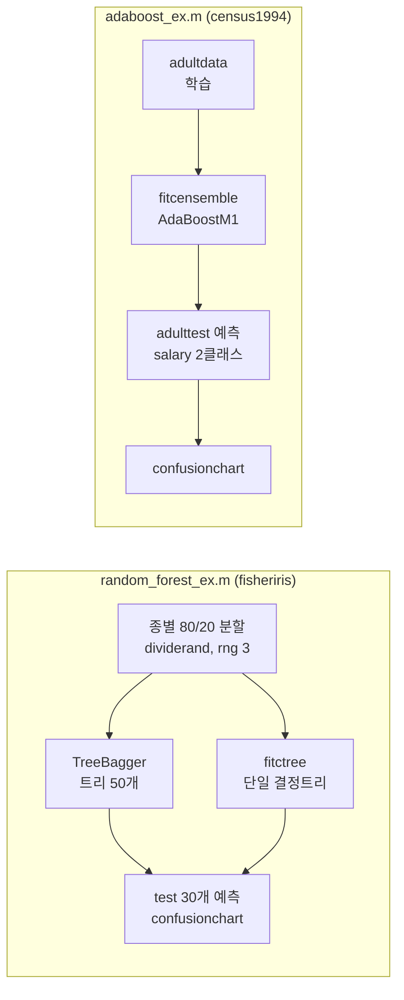
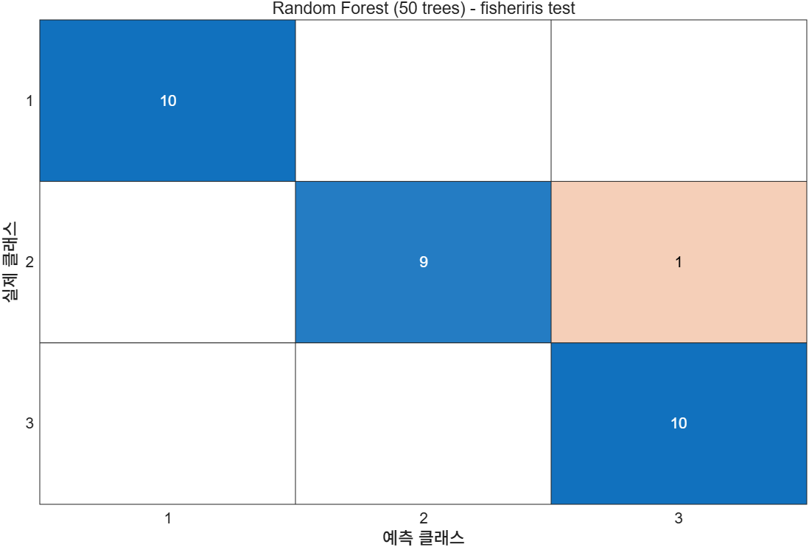
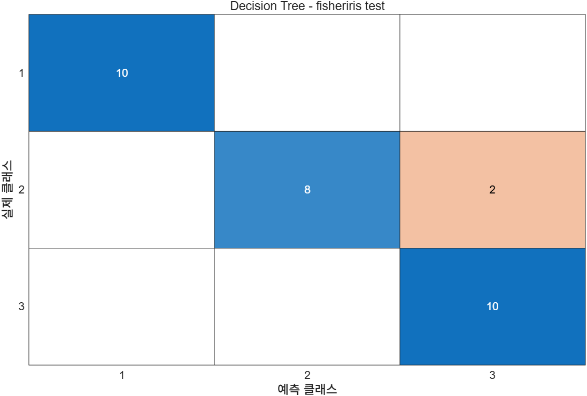
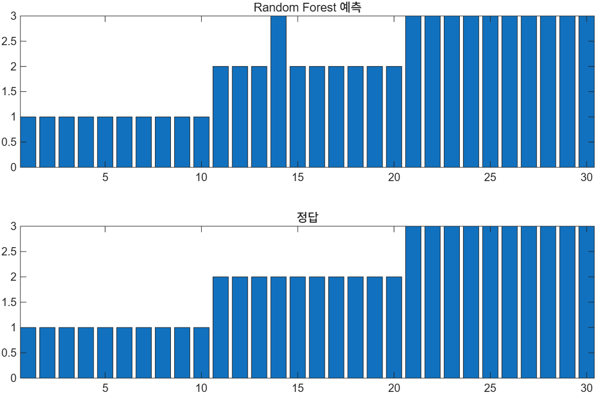
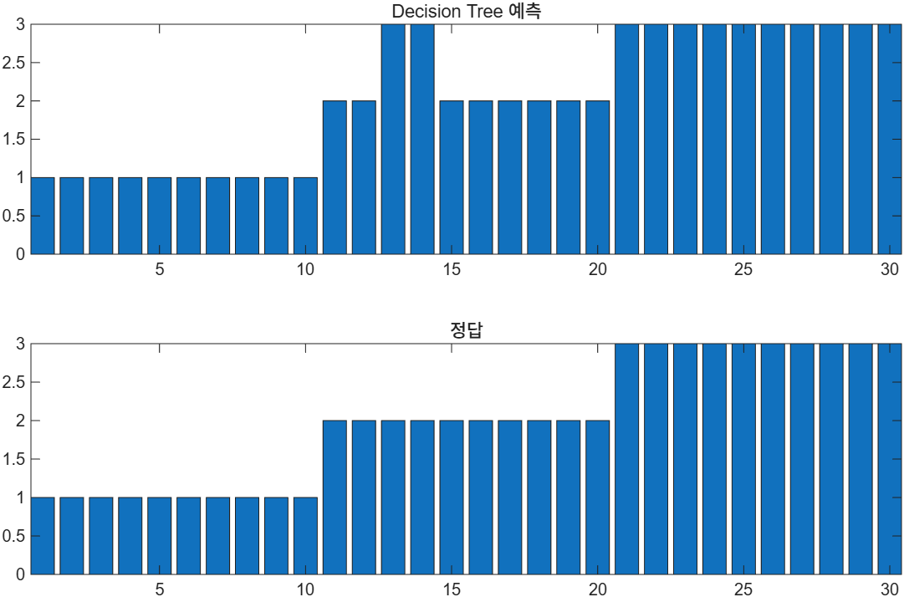
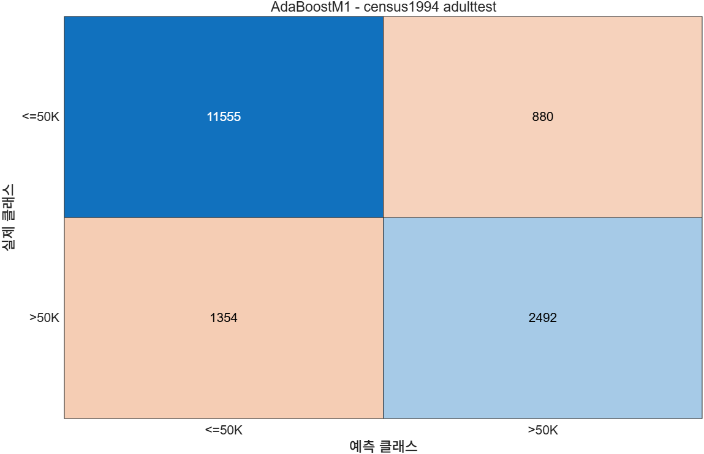

# 앙상블 (Random Forest · AdaBoost)

여러 개의 약한 모델을 합쳐 하나의 강한 모델을 만드는 앙상블 기법 두 가지를 MATLAB으로 실습했습니다.

> 배깅(Random Forest)은 독립적으로 학습한 여러 트리의 투표로 분산을 줄이고, 부스팅(AdaBoost)은 앞 분류기가 틀린 샘플에 가중치를 몰아줘 다음 분류기가 그 실수를 보완하게 만든다.

## 흐름

## 파일 설명

| 파일 | 데이터 | 내용 |
|---|---|---|
| `random_forest_ex.m` | fisheriris (150개, 특징 4개, 3종) | 종별로 80% 학습 / 20% 테스트로 나눈 뒤, 트리 50개짜리 랜덤 포레스트(`TreeBagger`)와 단일 결정트리(`fitctree`)를 같은 데이터로 학습해 비교. 첫 번째 트리 구조, 혼동행렬, 예측값·정답 막대그래프 출력 |
| `adaboost_ex.m` | census1994 (`adultdata` 학습, `adulttest` 테스트) | 나이·학력·직업 등 14개 변수로 연소득(`salary`, `<=50K` / `>50K`)을 분류. `fitcensemble`의 `AdaBoostM1`으로 학습하고 테스트셋 혼동행렬 출력 |
| `run_lab10_save.m` | - | 위 두 실습을 차례로 실행하고 혼동행렬·막대그래프를 `figures/`에, 정확도·혼동행렬 값을 `results.txt`에 저장하는 보조 스크립트 (실습 코드는 수정하지 않음) |
| `results.txt` | - | `run_lab10_save.m` 실행 결과 (MATLAB R2026a) |

## 코드에서 짚어볼 점

- **실행 환경**: `dividerand`는 Deep Learning Toolbox 함수라서, 이 툴박스가 없으면 `random_forest_ex.m` 19번째 줄에서 "인식할 수 없는 함수" 에러가 납니다. 나머지(`TreeBagger`, `fitctree`, `fitcensemble`)는 Statistics and Machine Learning Toolbox 함수입니다.
- **분할 방식**: `dividerand`를 종(50개)마다 따로 호출해서 테스트셋이 종별로 10개씩 정확히 30개가 됩니다(층화 분할 효과). `rng(3)`으로 고정했으므로 MATLAB에서는 매번 같은 분할이 나오고, 그 뒤에 이어지는 `TreeBagger`의 부트스트랩 추출도 같은 난수 흐름을 쓰기 때문에 아래 결과가 그대로 재현됩니다.
- **라벨 변환**: `TreeBagger`의 `predict`는 숫자 라벨을 넣어도 문자열 cell(`{'1'; '3'; ...}`)로 돌려줍니다. 그래서 `cell2mat` → `str2num`으로 다시 숫자로 바꿉니다. 라벨이 한 자리라서 동작하는 방식이고, `str2double(est_label)`을 쓰면 한 줄로 끝납니다.
- **랜덤 포레스트의 "변수 무작위 선택"**: `TreeBagger` 분류의 기본값은 분할마다 √(특징 수)개 후보만 보는 것이라, 붓꽃(특징 4개)에서는 분할마다 2개 특징 중에서 고릅니다. 강의자료의 "표본 추출 + 변수 선택" 두 가지 무작위성이 코드에 그대로 들어 있습니다.
- **AdaBoost의 약한 학습기는 스텀프가 아님**: 강의 예시는 깊이 1인 스텀프로 설명하지만, `fitcensemble`에서 부스팅을 쓰면 기본 트리는 `MaxNumSplits = 10`인 얕은 트리입니다. 학습 횟수 기본값은 100회입니다. 실제로 학습된 첫 번째 약한 학습기의 노드 수가 21개(분할 10번)로 확인됐습니다. 스텀프로 맞추고 싶다면 `'Learners', templateTree('MaxNumSplits',1)`을 넘기면 됩니다.
- **결측값**: census1994에는 `workClass`, `occupation`, `nativeCountry` 등에 결측값이 있지만 트리 기반 모델이라 별도 전처리 없이 학습·예측됩니다.
- **불균형 데이터**: 테스트셋 16,281명 중 `<=50K`가 약 76%라서, 전부 `<=50K`로 찍어도 정확도가 76% 정도 나옵니다. 그래서 전체 정확도보다 `>50K` 행의 재현율을 따로 보는 게 의미 있습니다(아래 결과 참고).

## 강의 손계산 예제 확인 (AdaBoost 첫 라운드)

강의자료의 심장병 8개 샘플 예시에서, 지니 불순도가 가장 낮은 `체중 > 176` 스텀프(지니 0.20)가 첫 분류기로 뽑히고 8개 중 1개(체중 167)를 틀립니다. 이후 계산을 Python으로 다시 확인했습니다.

| 단계 | 식 | 값 (Python 재현값) |
|---|---|---|
| 가중 오류율 | ε = 1/8 | 0.125 |
| 분류기 신뢰도 | α = ½ ln((1−ε)/ε) = ½ ln 7 | 0.9730 |
| 틀린 샘플 가중치 (정규화 전) | 1/8 · e^α | 0.3307 |
| 맞힌 샘플 가중치 (정규화 전) | 1/8 · e^−α | 0.0472 |
| 합계 Z | 0.3307 + 7 × 0.0472 | 0.6614 |
| 틀린 샘플 (정규화 후) | 0.3307 / 0.6614 | **0.5000** |
| 맞힌 샘플 (정규화 후) | 0.0472 / 0.6614 | **0.0714** |

- 강의자료는 반올림한 0.33, 0.05로 계산해서 정규화 결과가 0.49 / 0.07로 나옵니다. 반올림 없이 계산하면 틀린 샘플 하나가 정확히 **전체 가중치의 50%**를 가져갑니다. ε이 무엇이든 정규화 후 틀린 샘플들의 가중치 합은 항상 0.5가 됩니다.
- 이 가중치로 8개를 복원추출하면 167 샘플이 평균 8 × 0.5 = 4번 뽑힙니다(강의자료의 "약 4회").

## 결과 요약 (MATLAB 실행값, R2026a)

| 모델 | 데이터 | 테스트 정확도 |
|---|---|---|
| Random Forest (트리 50개) | fisheriris test 30개 | **96.7%** (29/30) |
| 단일 결정트리 (노드 7개) | fisheriris test 30개 | 93.3% (28/30) |
| AdaBoostM1 (약한 학습기 100개) | adulttest 16,281명 | 86.3% (14,047/16,281) |

- 붓꽃: 두 모델 모두 setosa(1)·virginica(3)는 10개씩 전부 맞혔고, 틀린 건 모두 **versicolor(2)를 virginica(3)로** 예측한 경우입니다. 랜덤 포레스트는 1개, 단일 트리는 2개를 틀렸습니다. 테스트가 30개뿐이라 1개 차이(3.3%p)를 일반적인 성능 차이로 보기는 어렵습니다.
- census1994: `<=50K`의 재현율은 92.9%(11,555/12,435)인데 `>50K`는 64.8%(2,492/3,846)에 그칩니다. 고소득자 3명 중 1명 정도를 `<=50K`로 놓친다는 뜻이라, 86.3%라는 전체 정확도만 보면 성능을 과대평가하게 됩니다.

## 그림

| Random Forest 혼동행렬 | 단일 결정트리 혼동행렬 |
|---|---|
|  |  |

| Random Forest 예측(위) vs 정답(아래) | 단일 결정트리 예측(위) vs 정답(아래) |
|---|---|
|  |  |

**AdaBoost 혼동행렬 (census1994)**

## 정리

- 배깅은 부트스트랩 표본마다 독립적으로 트리를 만들어 **병렬**로 학습하고 다수결로 합칩니다. 개별 트리의 편차가 평균되면서 단일 트리보다 안정적입니다.
- 부스팅은 앞 분류기의 오류를 다음 분류기가 보완하도록 **순차적**으로 학습하고, 신뢰도 α로 가중 투표합니다.
- 오류율 ε가 작을수록 α가 커지고, ε = 0.5(찍는 수준)면 α = 0이 되어 투표에 영향을 주지 않습니다.
