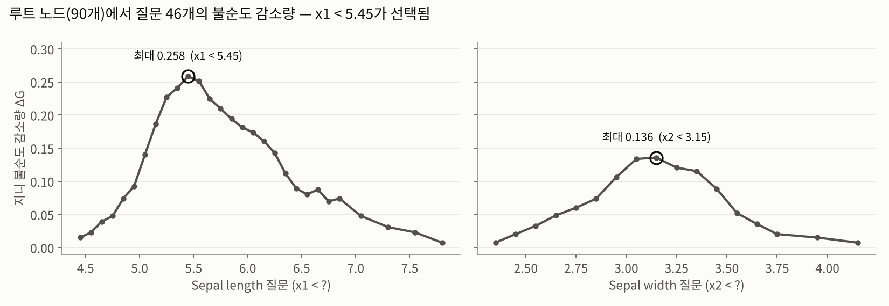
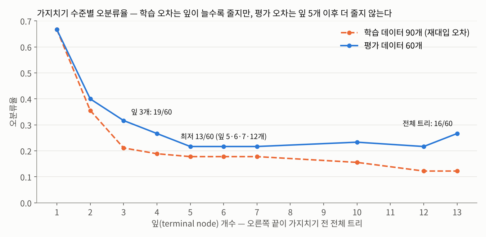

# Decision Tree (의사결정나무) — 붓꽃 분류

인공지능개론 6주차 실습 · 정보이론기반 인공지능  
Sepal length / width 2개 특징으로 붓꽃 3품종을 나누는 의사결정나무를 **지니 불순도로 직접 구현**하고(질문 생성 → 불순도 감소량 → 분할 → 사전 가지치기), MATLAB `fitctree`와 비교한 뒤 `cvloss`로 사후 가지치기까지 해봤다.

> **의사결정나무 = 불순도(섞인 정도)를 가장 많이 줄이는 질문 하나로 데이터를 둘로 나누고, 나뉜 그룹마다 이걸 반복한다.** 몇 번 나눠야 끝날지 미리 모르니까 while문과 멈춤 조건으로 돌린다.

| 파일 | 내용 |
| --- | --- |
| `dt_ex.m` | 직접 구현 **초안** — 노드마다 지니 감소량이 가장 큰 질문으로 나누고, 클래스가 하나만 남으면 잎. 종료 조건에 버그가 있다(아래) |
| `dt_ex_student_2.m` | 직접 구현 **완성본** (주석 포함) — 질문 생성(인접값의 중간값) → 지니 감소량 → 분할. 사전 가지치기 2종: 노드 데이터가 10개 미만이면 다수결 잎, 소수 클래스가 딱 1개면 다수 클래스로 잎. 마지막에 `fitctree`의 학습 데이터 예측과 비교 |
| `dt_ex_student_1.m` | 내장함수 — `fitctree` → 평가 데이터 60개 `predict` → `confusionchart`, `resubLoss`·`cvloss`로 가지치기 수준을 고른 뒤 `prune` |
| `dt_ex2.m` | **수정본** — 위 두 파일을 합친 교수님 코드에서 3곳을 고쳤다 (`% [수정]` 표시). 교수님 원본 `dt_ex2.m`은 이 레포에 없다 |

- 데이터 분할 (모든 파일 공통): 학습 90개 (품종별 21~50번째), 평가 60개 (품종별 1~20번째), 특징은 `meas(:,1:2)`
- `dt_ex.m` 종료 조건 버그: for 루프가 끝난 뒤 **마지막으로 처리한 노드**의 L/R만 보고 while을 끝낸다. 아직 나눌 노드가 남아 있어도 끝나서 학습 데이터 8개(순번 33, 43, 44, 52, 53, 68, 83, 87)가 라벨 0(미할당)으로 남는다. `dt_ex_student_2.m`은 "다음 단계에서 나눌 노드가 하나도 없을 때" 끝나서 이 문제가 없다. `dt_ex.m` 105번째 줄 `Final_Q = ...`는 세미콜론이 없어 반복마다 출력된다.
- `dt_ex2.m` 원본의 크기 불일치 오류: 마지막 비교 `matlab_label(:)-EST_LABEL(:)`에서 `matlab_label`은 평가 데이터 예측(60×1), `EST_LABEL`은 학습 데이터 분류 결과(90×1)라 빼기에서 오류가 난다 → 수정본은 `predict(mdl, Training_data)`로 학습 데이터 예측끼리 비교한다.
- 시드 미고정: `cvloss`는 학습 데이터를 무작위로 10겹으로 나누기 때문에 실행할 때마다 `bestlevel`(가지치기 수준)이 달라질 수 있다 → 수정본은 `cvloss` 앞에 `rng(0)`을 넣었다. `dt_ex_student_1.m`은 원본 그대로라 시드가 고정돼 있지 않다.
- 가지치기 그래프 창: `confusionchart` 바로 다음의 `plot`이 새 창 없이 같은 창에 그려진다 → 수정본은 `figure;`를 추가했다. `dt_ex_student_1.m` 49번째 줄은 원본 그대로다.
- 직접 구현은 **학습 데이터 90개의 라벨(`EST_LABEL`)만** 만든다. `Final_Q`는 고른 질문을 순서대로 쌓기만 하고 부모-자식 연결을 저장하지 않아서, 이 코드만으로는 평가 데이터를 예측할 수 없다.
- 질문 기준값: 직접 구현은 학습 데이터 **전체**에서 만든 중간값 46개 중에서 고르고, 라이브러리 트리는 **그 노드 안** 데이터의 중간값을 쓴다. 학습 데이터를 나누는 결과는 같아도 기준값 위치가 다를 수 있다 (예: 두 번째 질문 Sepal width 2.55 vs 2.75).
- 동점: 다수결에서 개수가 같으면 `max`가 앞 번호를 고른다 (잎 [versicolor 2, virginica 2] → versicolor).

**결과 요약**

- 아래 숫자는 모두 같은 로직을 Python으로 재현해 계산했다 (MATLAB에서 직접 확인한 값 아님). 직접 구현 부분은 Octave 8.4에서 원본 `.m`을 그대로 실행해 같은 값이 나오는 것도 확인했다. `fitctree` 부분은 같은 설정(지니, 분할 최소 샘플 10)의 scikit-learn `DecisionTreeClassifier`로 재현했다.

| | 직접 구현 (`dt_ex_student_2.m`) | `fitctree` 방식 (scikit-learn 재현) |
| --- | --- | --- |
| 질문 수 / 잎 수 | 12 / 13 | 14 / 15 (예측이 같은 형제 잎 2쌍 포함) |
| 학습 데이터 정답 | 79 / 90 (87.8%) | 79 / 90 — 90개 예측이 직접 구현과 모두 같음 |
| 평가 데이터 정답 | 코드에 예측 기능 없음 | 44 / 60 (73.3%) |

- 질문 후보: Sepal length 29개 + Sepal width 17개 = 46개
- 루트(30/30/30)의 지니 0.667 → 46개 중 **x1 < 5.45**가 감소량 0.258로 최대 (Sepal width 쪽 최대는 x2 < 3.15의 0.136) → 31개 / 59개로 나뉜다
- `Final_Q` (질문 값, 특징 번호): `5.45 1 | 2.55 2 | 6.15 1 | 3.45 2 | 6.85 1 | 5.75 1 | 3.15 2 | 3.05 2 | 6.55 1 | 2.95 2 | 2.35 2 | 2.85 2`, while 반복 8회. 잎 13개 중 6개는 데이터가 1~4개뿐이다
- 학습 데이터에서 틀린 11개 (붓꽃 원본 번호): setosa → versicolor 42 / versicolor → setosa 85 / versicolor → virginica 73, 92 / virginica → versicolor 122, 135, 138, 141, 143, 146, 148
- 평가 데이터 혼동행렬 (`fitctree` 방식, 행 = 실제 setosa / versicolor / virginica): [20 0 0], [0 14 6], [0 10 10]
- 직접 구현 트리를 노드 구조로 복원해 평가 데이터에 적용하면 43 / 60이다. 1개 차이는 위 "질문 기준값" 차이 때문이다 (60번 꽃 (5.2, 2.7)).
- `dt_ex.m` (초안): 질문 27개, 학습 데이터 82개는 정답, 8개는 미할당

가지치기 수준별 결과 (`fitctree` 방식 트리의 가지치기 순서). `cvloss`가 이 중 어느 크기를 고르는지는 무작위 10겹 분할에 따라 달라서 여기에는 적지 않았다.

| 잎 개수 | 13 (전체) | 12 | 10 | 7 | 6 | 5 | 4 | 3 | 2 | 1 |
| --- | --- | --- | --- | --- | --- | --- | --- | --- | --- | --- |
| 학습 정답 / 90 | 79 | 79 | 76 | 74 | 74 | 74 | 73 | 71 | 58 | 30 |
| 평가 정답 / 60 | 44 | 47 | 46 | 47 | 47 | 47 | 44 | 41 | 36 | 20 |

- 잎 3개 트리는 x1 < 5.45 → setosa / x1 < 6.15 → versicolor / 나머지 → virginica다. 잘려 나간 "x2 < 3.45?" 질문이 꽃받침이 긴 setosa 3개를 맞히고 있어서, 여기까지 자르면 평가 정답이 41개로 줄어든다.

**정리**
1. 의사결정나무는 "불순도 감소량이 가장 큰 질문으로 나누기"를 반복한다. 자식 불순도는 데이터 수로 가중평균하고, 연속형 특징의 질문 후보는 정렬한 인접값의 중간값이다.
2. 직접 구현과 `fitctree` 방식 트리는 학습 데이터를 똑같이 나눈다. 다만 기준값을 어디서 뽑는지가 달라서 처음 보는 데이터에서는 예측이 조금 다를 수 있다.
3. 크기가 다른 L/R 데이터는 셀 배열 `{}`로, 원래 위치는 순번 열로 관리한다. while의 종료 조건은 모든 노드를 확인한 뒤 판단해야 한다 (`dt_ex.m` 버그).
4. setosa는 첫 질문에서 거의 다 갈리고, 나머지 질문은 versicolor ↔ virginica를 나누는 데 쓰인다. 학습 87.8% → 평가 73.3%이고, 데이터 1~4개짜리 잎이 6개라 과적합 신호다.
5. 잎을 줄이면 학습 오차는 계속 늘지만, 평가 오차는 잎 5개 이후로 더 줄지 않고 3개 이하로 자르면 나빠진다. 어디까지 자를지는 평가 데이터가 아니라 교차검증 오차로 정한다.
