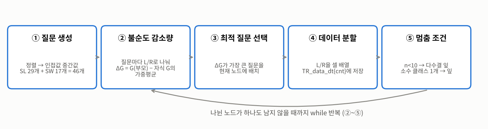
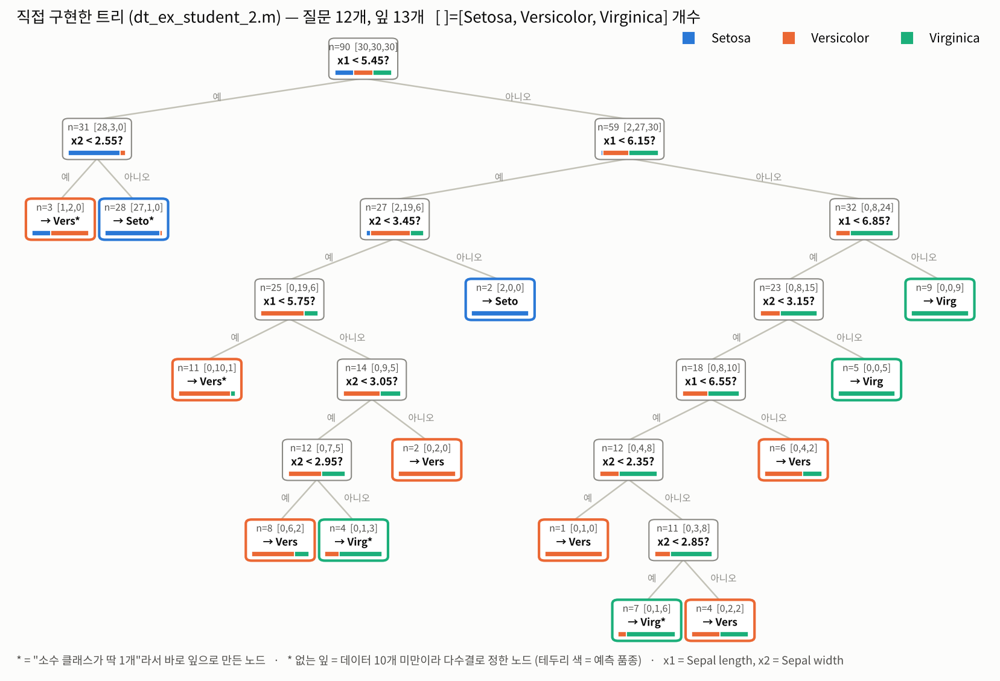
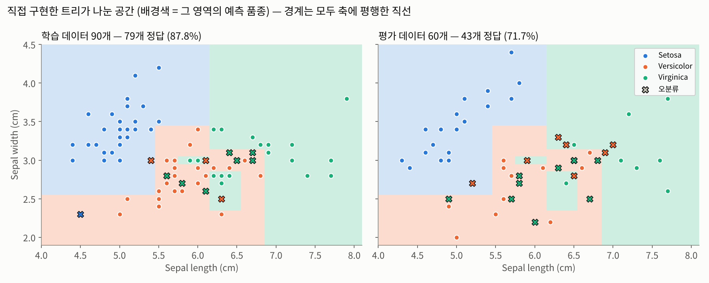

# Decision Tree (의사결정나무) — 붓꽃 분류

인공지능개론 6주차 실습 · 정보이론기반 인공지능  
Sepal length / width 2개 특징으로 붓꽃 3품종을 분류하는 의사결정나무를 **지니 불순도로 직접 구현**하고, MATLAB `fitctree` 결과와 비교했다.

| 파일 | 내용 |
| --- | --- |
| `dt_ex.m` | 직접 구현 초안 — 종료 조건이 마지막 노드만 확인해서 학습 데이터 8개가 미할당(0)으로 남음 |
| `dt_ex_student_2.m` | 직접 구현 완성본 — 질문 생성 → 불순도 감소량 → 분할 → 사전 가지치기 2종 |
| `dt_ex_student_1.m` | 내장함수 `fitctree` → 평가 데이터 예측 → `cvloss`로 사후 가지치기 |
| `dt_ex2.m` | 위 두 파일 통합본 (`% [수정]` 표시 3곳: 크기 불일치 오류 수정, `figure;` 추가, `rng(0)` 시드 고정) |

- 데이터 분할: 학습 90개 (품종별 21~50번째), 평가 60개 (품종별 1~20번째)
- 직접 구현 결과: 질문 12개 · 잎 13개, 학습 데이터 **79/90 (87.8%)** — 같은 설정(분할 최소 샘플 10, 지니)으로 만든 트리와 학습 데이터 90개 예측이 모두 일치 (Python scikit-learn으로 교차 확인)

