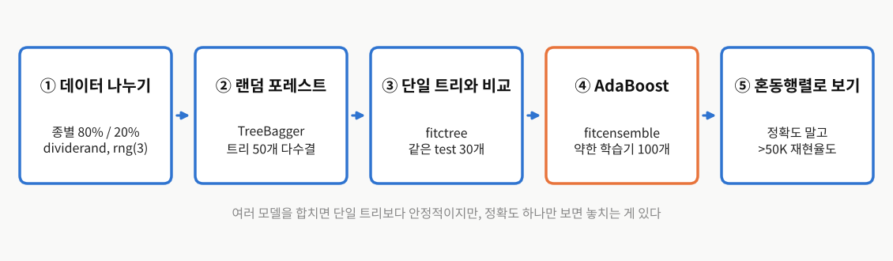
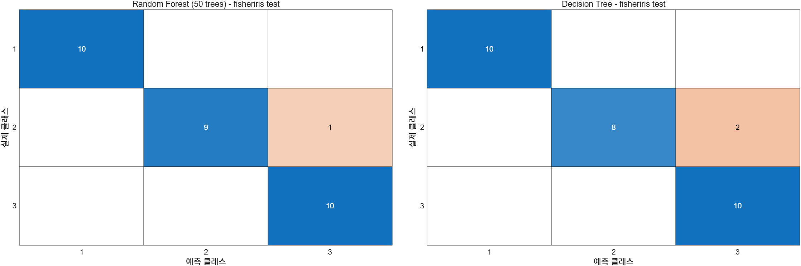
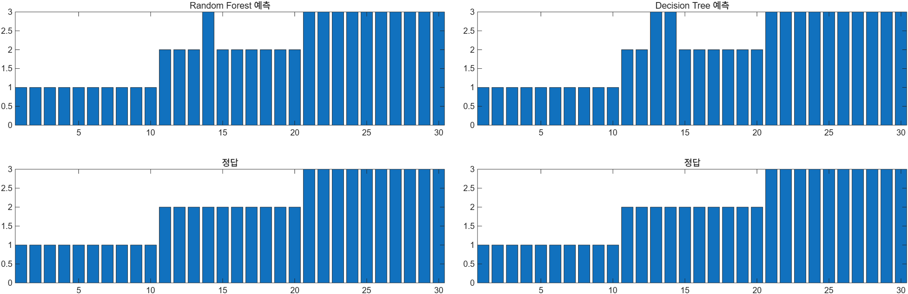
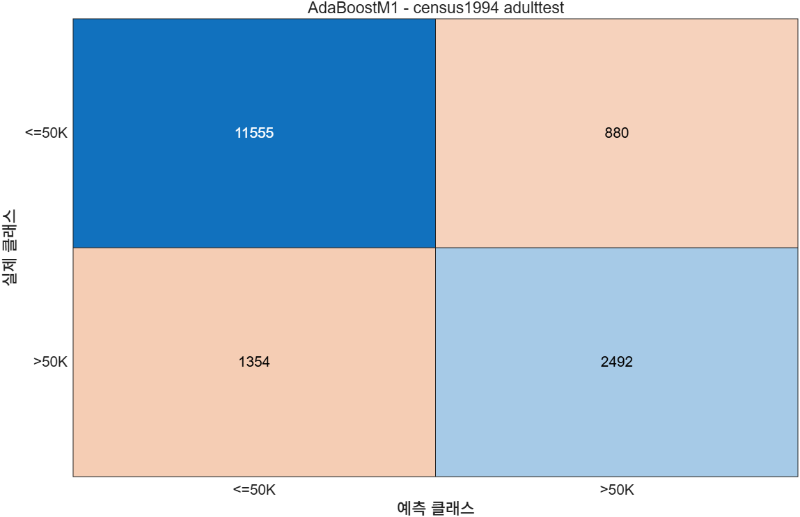

# 앙상블 — 랜덤 포레스트 · AdaBoost

인공지능개론 10주차 실습 · 앙상블기반 인공지능 (Random Forest, AdaBoost)  
붓꽃 데이터로 **랜덤 포레스트**(트리 50개)와 **단일 결정트리**를 같은 테스트셋에서 비교하고 → census1994 데이터로 **AdaBoost**를 돌려 연소득 50K 초과 여부를 분류했다. 과제는 없던 주차라 수업 실습 코드만 정리했다.

> **배깅(랜덤 포레스트) = 부트스트랩 표본마다 트리를 따로 키워서 다수결 / 부스팅(AdaBoost) = 앞 분류기가 틀린 샘플에 가중치를 몰아주고 다음 분류기가 그걸 보완, 마지막엔 신뢰도 α로 가중 투표.** 배깅은 병렬, 부스팅은 순차다.

| 파일 | 내용 |
| --- | --- |
| `random_forest_ex.m` | fisheriris 150개를 **종별로** 80% / 20% 분할(`dividerand`, `rng(3)`) → `TreeBagger` 트리 50개로 랜덤 포레스트, `fitctree`로 단일 결정트리를 학습해 같은 test 30개로 비교. 첫 번째 트리 구조, 혼동행렬, 예측·정답 막대그래프 출력 |
| `adaboost_ex.m` | census1994 — `adultdata` 32,561명으로 학습, `adulttest` 16,281명으로 테스트. 나이·학력·직업 등 14개 변수로 `salary`(`<=50K` / `>50K`) 분류. `fitcensemble(..., 'Method', 'AdaBoostM1')` |

- `dividerand`는 **Deep Learning Toolbox** 함수다. 이 툴박스가 없으면 19번째 줄에서 "인식할 수 없는 함수" 에러가 난다. `TreeBagger`·`fitctree`·`fitcensemble`은 Statistics and Machine Learning Toolbox.
- `dividerand`를 종(50개)마다 따로 불러서 test가 종별로 정확히 10개씩 30개가 된다. `rng(3)`이 맨 앞에 있어서 분할뿐 아니라 뒤의 `TreeBagger` 부트스트랩까지 같은 난수 흐름을 타고, 그래서 아래 결과가 매번 똑같이 나온다.
- `TreeBagger`의 `predict`는 숫자 라벨을 넣어도 문자열 cell(`{'1'; '3'; ...}`)로 돌려준다. 그래서 `cell2mat` → `str2num`으로 다시 숫자로 바꾼다. 라벨이 한 자리라서 되는 방식이고 `str2double(est_label)` 한 줄로도 된다.
- `TreeBagger` 분류는 기본으로 분할마다 √(특징 수)개 후보만 본다. 붓꽃은 특징이 4개라 **분할마다 2개 중에서** 고른다. 강의의 "표본 무작위 + 변수 무작위" 두 가지가 코드에 그대로 들어 있다.

**버그·특이점 — AdaBoost의 약한 학습기는 스텀프가 아니다**

- 강의 예시는 깊이 1인 스텀프로 설명하지만, `fitcensemble`에서 부스팅을 쓰면 기본 트리는 `MaxNumSplits = 10`인 얕은 트리다. 실제로 학습된 첫 번째 약한 학습기의 노드 수가 **21개(분할 10번)**였다. 학습 횟수 기본값은 100회.
- 강의처럼 스텀프로 맞추려면 `'Learners', templateTree('MaxNumSplits', 1)`을 넘기면 된다.
- census1994에는 `workClass`, `occupation`, `nativeCountry` 등에 결측값이 있는데, 트리 기반이라 전처리 없이 그대로 학습·예측된다.

**강의 손계산 확인 — AdaBoost 첫 라운드**

강의자료의 심장병 8개 샘플 예시에서 지니 불순도가 가장 낮은 `체중 > 176` 스텀프(지니 0.20)가 첫 분류기로 뽑히고, 8개 중 1개(체중 167)를 틀린다. 그 뒤 계산을 Python으로 다시 해봤다.

| 단계 | 식 | 값 |
| --- | --- | --- |
| 가중 오류율 | ε = 1/8 | 0.125 |
| 분류기 신뢰도 | α = ½ ln((1−ε)/ε) = ½ ln 7 | 0.9730 |
| 틀린 샘플 (정규화 전) | 1/8 · e^α | 0.3307 |
| 맞힌 샘플 (정규화 전) | 1/8 · e^−α | 0.0472 |
| 합계 Z | 0.3307 + 7 × 0.0472 | 0.6614 |
| 틀린 샘플 (정규화 후) | 0.3307 / 0.6614 | **0.5000** |
| 맞힌 샘플 (정규화 후) | 0.0472 / 0.6614 | **0.0714** |

- 강의자료는 0.33, 0.05로 반올림해서 계산해서 정규화 결과가 0.49 / 0.07로 나온다. 반올림 없이 하면 틀린 샘플 하나가 정확히 **전체 가중치의 50%**를 가져간다. ε이 얼마든 정규화 후 틀린 샘플들의 가중치 합은 항상 0.5가 된다.
- 이 가중치로 8개를 복원추출하면 167 샘플이 평균 8 × 0.5 = 4번 뽑힌다 (강의자료의 "약 4회").

**결과 요약**

- MATLAB R2026a에서 두 파일을 직접 실행해 확인한 값이다.

| 모델 | 데이터 | 테스트 정확도 |
| --- | --- | --- |
| 랜덤 포레스트 (트리 50개) | 붓꽃 test 30개 | **96.7%** (29/30) |
| 단일 결정트리 (노드 7개) | 붓꽃 test 30개 | 93.3% (28/30) |
| AdaBoostM1 (약한 학습기 100개) | adulttest 16,281명 | 86.3% (14,047/16,281) |

- 붓꽃: 두 모델 다 setosa(1)·virginica(3)는 10개씩 전부 맞혔고, 틀린 건 전부 **versicolor(2) → virginica(3)**다. 랜덤 포레스트는 84번 1개, 단일 트리는 73번·84번 2개를 틀렸다. test가 30개뿐이라 1개 차이(3.3%p)를 일반적인 성능 차이로 보긴 어렵다.
- census1994: test 중 `<=50K`가 약 76%라서 전부 `<=50K`로 찍어도 정확도가 76%쯤 나온다. 클래스별로 보면 `<=50K` 재현율은 92.9%(11,555/12,435)인데 `>50K`는 **64.8%**(2,492/3,846)다. 고소득자 3명 중 1명꼴로 놓친다는 뜻이라, 86.3%만 보면 성능을 과대평가하게 된다.

**정리**
1. 배깅은 부트스트랩 표본마다 트리를 독립적으로 만들어 병렬로 학습하고 다수결로 합친다. 트리 하나하나의 편차가 평균되면서 단일 트리보다 안정적이다.
2. 랜덤 포레스트는 배깅에 "분할마다 변수 일부만 후보로 보기"를 더한 것이다. 트리끼리 덜 비슷해져서 다수결 효과가 커진다.
3. 부스팅은 앞 분류기의 오류를 다음 분류기가 보완하도록 순차적으로 학습하고, 신뢰도 α로 가중 투표한다. ε이 작을수록 α가 커지고, ε = 0.5(찍는 수준)면 α = 0이라 투표에 영향이 없다.
4. 클래스가 한쪽으로 쏠린 데이터는 전체 정확도보다 혼동행렬에서 소수 클래스의 재현율을 따로 봐야 한다.
