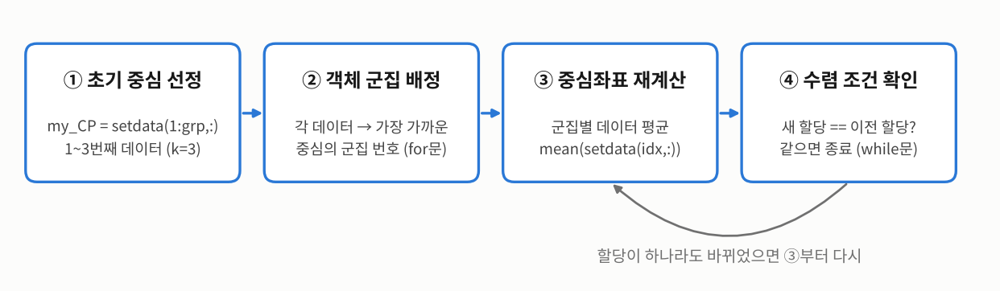
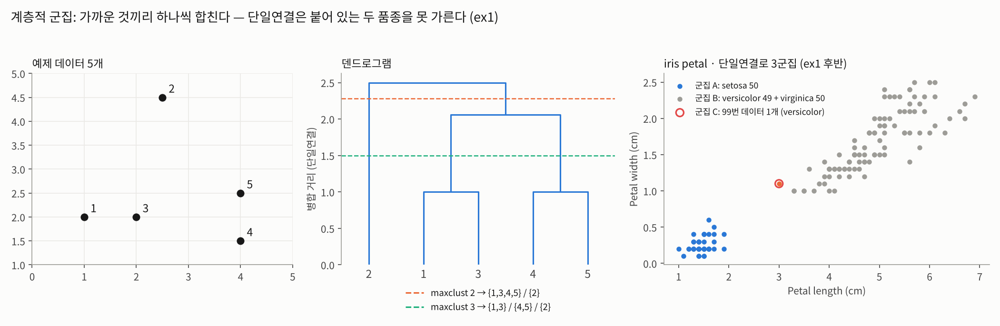
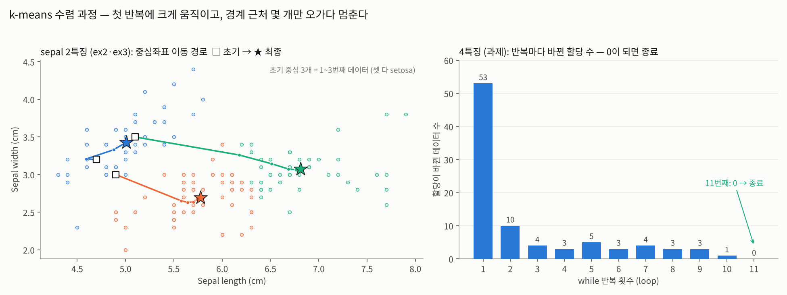
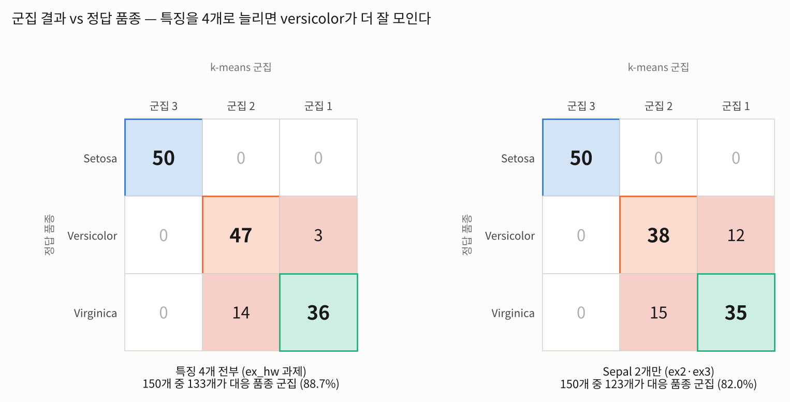
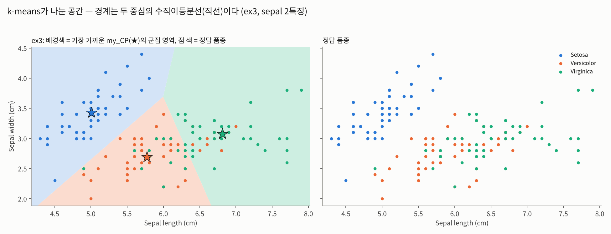

# K-means 군집화 — 붓꽃 군집

인공지능개론 4주차 실습·과제 · 유사성기반 인공지능 (Clustering)  
계층적 군집으로 "가까운 것끼리 합치기"를 먼저 보고 → k-means를 **직접 구현**한 뒤 → 과제로 그 코드를 `my_kmeans` **함수로 만들어** 붓꽃 4개 특징 전부에 적용하고 MATLAB `kmeans`와 비교했다.

> **k-means = 가장 가까운 중심에 붙이기 ↔ 붙은 점들의 평균으로 중심 옮기기를 할당이 더 이상 안 바뀔 때까지 반복.** 정답(품종) 없이 묶기 때문에 군집 번호 1, 2, 3 자체에는 의미가 없다.

| 파일 | 내용 |
| --- | --- |
| `ex1_HierarchicalClustering.m` | 계층적 군집 — 예제 5개 점으로 `pdist` → `linkage`(단일연결) → `dendrogram` → `cluster`, 이어서 iris petal 2특징을 3군집으로 |
| `ex2_nonHierarchicalClustering_kmeans.m` | k-means **직접 구현** (sepal 2특징, k=3, 초기 중심 = 1~3번째 데이터). 내장 `kmeans`는 `'Start'` 없이 호출 |
| `ex3_kmeans_space.m` | ex2와 같은 구현 + 내장 `kmeans`에 `'Start', setdata(1:3,:)`로 초기값을 맞춤 → `meshgrid` 격자점으로 **공간 분리** 시각화 |
| `my_kmeans_202310859.m` | **과제** — 수업 코드를 `[Final_label, my_CP] = my_kmeans_학번(setdata, grp, class)` 함수로 일반화 (빈 군집이면 이전 중심 유지) |
| `ex_hw_1202310859.m` | **과제 메인** — 4개 특징 전부(`meas(:,1:4)`)로 `my_kmeans`와 내장 `kmeans`(같은 `'Start'`) 결과 비교 |

- ex2는 내장 `kmeans`를 `'Start'` 없이 불러서 실행할 때마다 초기 중심이 달라진다. 그래서 내장함수와의 비교(`mat_label - Final_label`)는 ex3·과제처럼 초기값을 맞춰야 의미가 있다.
- ex3의 while문은 수렴하면 `chk = 1`로 두지만 바로 `break`로 빠져나오므로 동작은 ex2와 같다.

**결과 요약**

- 과제 (4특징, k=3): `my_kmeans`와 내장 `kmeans`의 **할당이 다른 데이터 0개, 중심좌표 최대 오차 1.33e-15** — MATLAB에서 `ex_hw_1202310859.m`을 직접 실행해 확인한 값
- 아래 숫자는 같은 로직을 Python으로 재현해 계산했다 (MATLAB에서 직접 확인한 값 아님). 재현 코드는 scikit-learn `KMeans`(같은 초기 중심, Lloyd 방식)와 할당 150개가 모두 같았고, 최종 중심좌표도 위 MATLAB 출력과 소수 4자리까지 같다.

| | 4특징 (과제) | sepal 2특징 (ex2·ex3) |
| --- | --- | --- |
| while 반복 횟수 | 11 | 6 |
| 군집 크기 (1 / 2 / 3) | 39 / 61 / 50 | 47 / 53 / 50 |
| 정답 품종과 대응되는 군집에 들어간 수 | 133 / 150 (88.7%) | 123 / 150 (82.0%) |

- 최종 중심좌표 (4특징): 군집 1 `[6.8538 3.0769 5.7154 2.0538]`, 군집 2 `[5.8836 2.7410 4.3885 1.4344]`, 군집 3 `[5.0060 3.4280 1.4620 0.2460]`
- "대응되는 군집"은 군집 3 = setosa, 2 = versicolor, 1 = virginica로 다수결 매칭해서 센 값이다. 학습에 정답을 안 쓰므로 분류 정확도와 같은 의미는 아니다.
- ex1 (예제 5개 점, 단일연결): {1,3}과 {4,5}가 거리 1.0에서 먼저 합쳐지고, 둘이 2.0616에서, 마지막에 2번이 2.5에서 합류 → `maxclust 2`는 {1,3,4,5} / {2}, `maxclust 3`은 {1,3} / {4,5} / {2}
- ex1 (iris petal, 단일연결 3군집): setosa 50개는 한 군집, **versicolor 49 + virginica 50이 한 군집**, 99번 데이터(versicolor) 1개가 혼자 한 군집
- ex3 공간 분리: 코드와 같은 361×361 격자 기준으로 영역 비율 군집 1 46.2% · 군집 2 21.9% · 군집 3 31.8%

**정리**
1. 직접 구현과 내장 `kmeans`는 같은 과정(초기 중심 → 가까운 중심에 할당 → 평균으로 중심 이동 → 할당이 그대로면 종료)이고, 초기 중심을 같게 맞추면 결과도 같다.
2. 반복 횟수를 미리 알 수 없어서 수렴 확인은 for문이 아니라 while문으로 한다. 초기 중심 3개가 모두 setosa여도 첫 반복에서 크게 재배치된 뒤 경계 근처 몇 개만 오가다 멈춘다.
3. 함수로 바꾸면 입력(데이터·k·클래스 번호)만 바꿔서 2특징 코드를 4특징에 그대로 쓸 수 있다.
4. setosa는 어떤 특징으로도 한 군집에 모이고, 섞이는 건 versicolor ↔ virginica다. petal을 더하면 82.0% → 88.7%로 나아진다.
5. k-means의 경계는 두 중심의 수직이등분선이라 공간이 직선으로 나뉜다. 단일연결 계층적 군집은 가까운 점을 사슬처럼 이어 붙여서, 붙어 있는 두 품종을 하나로 묶어버린다.
