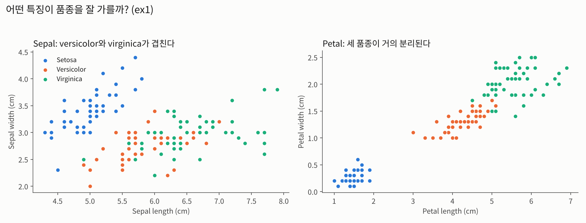
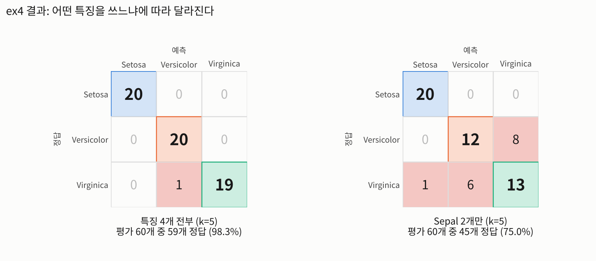
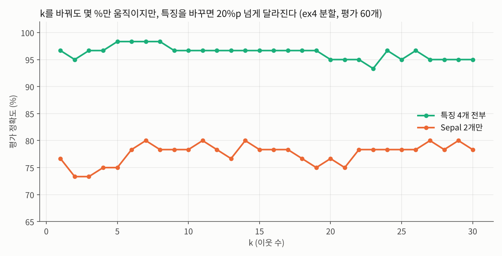
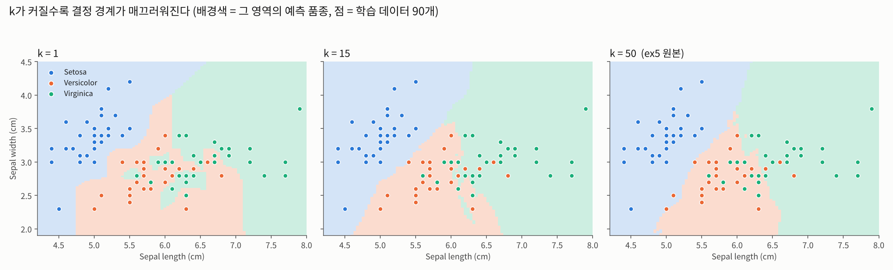

# KNN (K-Nearest Neighbor) — 붓꽃 분류

인공지능개론 실습 · 거리 기반 분류  
붓꽃(iris) 데이터로 KNN 분류기를 `fitcknn`으로 먼저 써보고 → **직접 구현**하고 → 3품종·4특징으로 일반화한 뒤 → 결정 경계까지 그려봤다.

> **KNN = 가장 가까운 k개 이웃의 다수결.** 새 데이터가 들어오면 학습 데이터와의 거리를 재서 가까운 k개를 뽑고, 그중 가장 많은 품종으로 분류한다.

| 파일 | 내용 |
| --- | --- |
| `ex1_dataload_visualization.m` | 데이터 불러오기 → 품종을 숫자로 변환 → sepal / petal 산점도 → 학습·평가 데이터 분리 |
| `ex2_knn_using_matlab.m` | `fitcknn` + `predict` 두 줄로 KNN (versicolor vs virginica, sepal 2특징, k=3) |
| `ex3_knn_my_style.m` | 같은 문제를 거리 계산부터 **직접 구현**, 마지막에 `fitcknn` 결과와 비교 |
| `ex4_knn_generalization.m` | 거리 계산을 벡터화(`sum((a-b).^2)`)해서 **3품종·4특징**으로 확장 (k=5) |
| `ex5_knn_space.m` | `meshgrid` 격자점을 전부 분류해 **결정 경계** 시각화 (sepal 2특징, k=50) |

- 데이터 분할: ex2·ex3은 학습 60개 / 평가 40개, ex4·ex5는 품종별 21\~50번째를 학습(90개), ex4는 1\~20번째를 평가(60개)
- ex2·ex3 (sepal 2특징, k=3): 평가 40개 중 **24개 정답 (60.0%)** — versicolor와 virginica가 sepal에서 많이 겹쳐서 어렵다
- ex4 (특징 4개, k=5): 평가 60개 중 **59개 정답 (98.3%)**, 같은 분할에서 sepal 2개만 쓰면 45개 (75.0%)
- 직접 구현한 코드는 Python으로 같은 로직을 재현해 scikit-learn `KNeighborsClassifier`와 예측이 모두 일치하는 것을 확인했다. 위 정확도도 이 재현 값이다.

**내가 해본 것**

`ex4`를 복사해서 숫자 몇 개만 바꿔 돌려봤다. 원래는 평가 60개 중 59개 정답. (원인은 같은 로직을 Python으로 돌려서 확인)

- **petal 2개만 사용**: 58개. 4개 다 쓸 때와 거의 같다. 틀린 건 107번(virginica인데 이웃 5개가 전부 versicolor)과 120번이고, 107번은 4개를 써도 틀린다.
- **k=60 → 40개, k=90 → 20개**: 학습 데이터가 품종당 30개라서 k=60이면 virginica 평가 데이터 대부분이 versicolor 30 : virginica 30 동점이 된다. `mode`는 동점이면 작은 번호를 고르기 때문에 virginica가 한 번도 안 나왔다(예측 개수 20 40 0). k=90은 세 품종이 30:30:30이라 전부 setosa(60 0 0).
- **sepal width에 ×10 → 52개, ×100 → 43개**: 값은 그대로고 단위만 바꿨는데 정확도가 떨어졌다. 거리에서 sepal width 비중이 커져서 이웃이 달라진 것. ×10은 예측 개수가 20 20 20으로 딱 맞는데도 8개가 틀렸다(versicolor↔virginica 4개씩 맞바뀜). 개수만 봐서는 정확도를 알 수 없다.
- **알게 된 점**: k는 한 품종의 학습 데이터 수(30)를 넘기면 동점 때문에 망가지고, KNN은 특징들의 단위를 맞춰야 한다.

**정리**
1. 직접 구현과 내장함수는 같은 4단계(거리 → 정렬 → 상위 k개 → 다수결)이고, 결과도 같다.
2. 벡터화하면 특징이 2개든 4개든, 품종이 2개든 3개든 같은 코드를 쓸 수 있다.
3. k는 모델 복잡도를 조절한다. 작으면 경계가 울퉁불퉁하고 점 하나에 민감하고, 크면 매끄럽지만 다수결이 동점이 되거나 한 품종에 묻힌다(직접 해본 것: k가 품종당 학습 데이터 수 30을 넘으면 `mode`가 동점에서 작은 번호를 골라 virginica가 사라졌다).
4. k가 작은 범위에서는 바꿔도 정확도가 몇 % 안에서 움직이지만, 어떤 특징을 쓰느냐는 20%p 넘게 바꾼다. 특징의 단위(스케일)를 바꾸는 것만으로도 59개 → 43개까지 떨어졌다.
