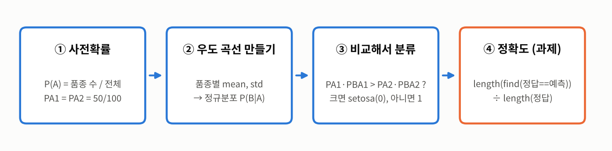
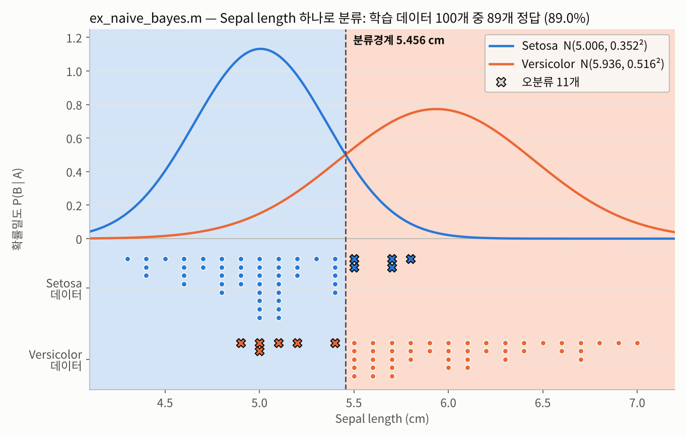
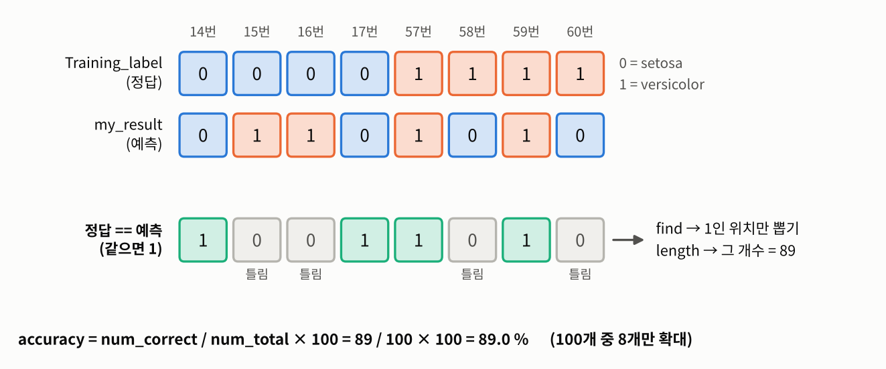
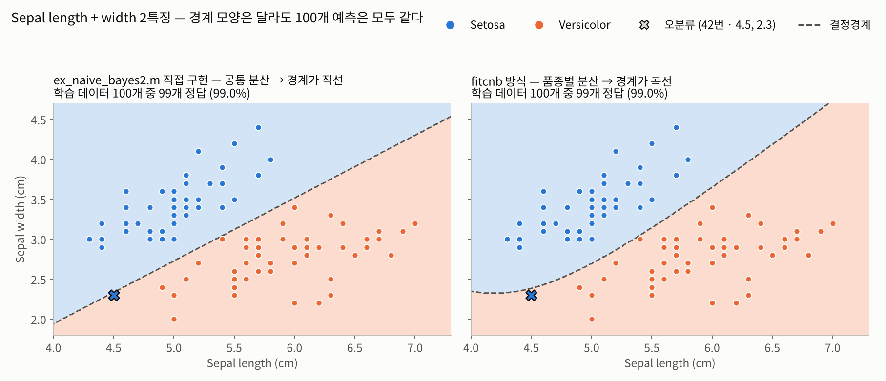

# Naive Bayes (나이브 베이즈) — 붓꽃 분류

인공지능개론 5주차 실습·과제 · 확률기반 인공지능  
setosa / versicolor 100개를 **베이즈 정리로 직접 분류**하고(Sepal length 1특징 → Sepal length + width 2특징), 과제로 그 결과의 **정확도를 `find`·`length`로 계산**해 MATLAB `fitcnb`와 비교했다.

> **나이브 베이즈 = 품종마다 "우도 × 사전확률"을 계산해서 큰 쪽을 고른다.** 우도 P(B|A)는 품종별 평균·표준편차로 만든 정규분포 곡선의 높이이고, 분모 P(B)는 두 품종에 공통이라 비교할 때 빼도 된다.

| 파일 | 내용 |
| --- | --- |
| `ex_naive_bayes.m` | **실습 + 과제** — Sepal length 1특징. 사전확률 `PA1`·`PA2` → 품종별 `mean`·`std`로 정규분포 → `PA1*PBA1 > PA2*PBA2`면 setosa(0). 끝부분(96번째 줄~)에 **과제: 정확도 계산** (`length(find(Training_label == my_result)) / length(Training_label)`) |
| `ex_naive_bayes2.m` | Sepal length + width 2특징. 특징끼리 독립(분산행렬 대각선만 사용)으로 두고 판별함수를 직선 `Gx_grad*(x - Gx_offset) > 0`으로 정리해 분류, 경계선을 그림 |

- 두 파일 모두 **학습에 쓴 100개로 다시 평가**한다(학습/평가 분리 없음). `fitcnb`는 랜덤 요소가 없어서 실행할 때마다 결과가 같다.
- `ex_naive_bayes.m`: 26~66번째 줄과 69~95번째 줄이 같은 계산(사전확률 → 평균·표준편차 → 분류)을 한 번 더 반복한다. 그래프용 `PBA1 = PBA1/sum(PBA1)`은 합이 1이 되게 나눈 값이라 확률밀도가 아니다(0.1 간격 격자라 원래 합이 10). 분류는 나누기 전 값으로 한다. 범례 `'setota'`는 오타.
- `ex_naive_bayes2.m`: `SIGMA`가 **두 품종을 합친 100개 전체의 분산**(`var(Training_data(:,k))`)이라, 품종별 분산도 품종 내 공통 분산도 아니다. 두 품종이 같은 분산을 쓰므로 경계가 직선이 된다.
- `ex_naive_bayes2.m` 62번째 줄 `log(prior_set(1,1)/prior_set(2,1))`는 부호가 반대다. 판별함수가 versicolor 쪽(`dmean = 평균2 − 평균1`)으로 잡혀 있으니 `log(P(versicolor)/P(setosa))`여야 한다. 지금은 사전확률이 0.5 : 0.5라 log 값이 0이어서 결과에 영향이 없지만, 0.75 : 0.25로 바꾸면 로그우도로 직접 비교한 결과와 **17개**가 달라진다(Python 재현).

**결과 요약**

- 과제 (`ex_naive_bayes.m`): **제대로 찾은 개수 89개 / 전체 100개, 정확도 89.0%, `fitcnb` 정확도 89.0%** — MATLAB 실행값
- 아래 숫자는 같은 로직을 Python으로 재현해 계산했다 (MATLAB에서 직접 확인한 값 아님). `fitcnb` 기본 설정(품종별 정규분포, 평균 + 불편 표준편차, 경험적 사전확률)을 같은 식으로 재현했고, scikit-learn `GaussianNB`와 100개 예측이 모두 같았다. 재현한 정확도 89개는 위 MATLAB 실행값과 같다.

| | 1특징 (`ex_naive_bayes.m`) | 2특징 (`ex_naive_bayes2.m`) |
| --- | --- | --- |
| 직접 구현 정답 수 | 89 / 100 (89.0%) | 99 / 100 (99.0%) |
| `fitcnb` 방식 정답 수 | 89 / 100 | 99 / 100 |
| 직접 구현과 `fitcnb` 예측이 다른 데이터 | 0개 | 0개 (경계 모양은 직선 vs 곡선으로 다름) |
| 틀린 데이터 | 15·16·19·34·37번 (setosa → versicolor), 58·60·61·85·94·99번 (versicolor → setosa) | 42번 (4.5, 2.3) setosa → versicolor |

- 1특징 품종별 정규분포: setosa N(5.006, 0.352²), versicolor N(5.936, 0.516²) → 두 곡선이 만나는 **분류경계 5.456cm** (5.456보다 작으면 setosa). 분산이 달라서 2.93cm에서 한 번 더 만나지만 데이터 범위(4.3~7.0cm) 밖이다.
- 1특징 혼동행렬: 실제 setosa 50개 중 45개, 실제 versicolor 50개 중 44개를 맞힘. 틀린 11개는 모두 4.9~5.8cm, 두 곡선이 겹치는 구간에 있다.
- 예시 x = 5.5cm: 우도 setosa 0.424, versicolor 0.541 → 사후확률 43.9% vs **56.1%** → versicolor
- 2특징 `ex_naive_bayes2.m` 값: `mean_set` = [5.006 5.936; 3.428 2.770], `SIGMA` 대각 = [0.4118, 0.2292], `Gx_grad` = [2.2585, −2.8710], `Gx_offset` = [5.471, 3.099] → 경계선 **width = 0.7867 × length − 1.2049**

**정리**
1. 나이브 베이즈는 결국 "우도 × 사전확률" 비교 한 줄이다. 사전확률이 같으면 두 정규분포 곡선이 만나는 점이 그대로 분류경계가 된다.
2. 정확도는 `정답 == 예측`으로 0/1 벡터를 만들고 → `find`로 1인 위치를 뽑아 → `length`로 세서 전체 개수로 나눈다. 두 벡터가 둘 다 세로(100×1)여야 `==`가 원소끼리 비교된다.
3. 직접 구현과 `fitcnb`가 같은 결과를 낸다는 건, 내장함수 안에서도 평균·표준편차 → 정규분포 → 우도 × 사전확률 비교가 일어난다는 뜻이다.
4. 1특징으로 틀린 11개는 길이만으로는 원리적으로 구분이 안 되는 꽃들이다. 너비를 더하면 89% → 99%가 된다.
5. 분산을 두 품종이 공유하면 경계가 직선, 품종별로 따로 두면 곡선이 된다. 이 데이터에서는 경계 모양이 달라도 100개 예측은 같았다.
