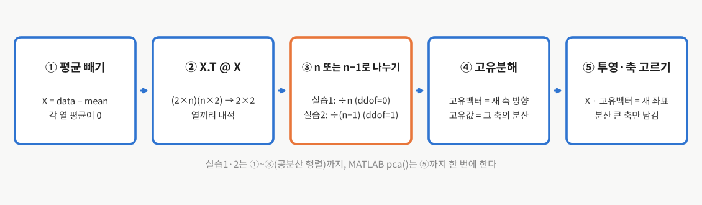
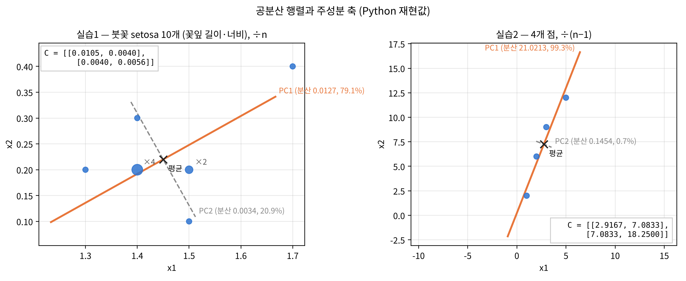

# 차원축소 — 공분산 행렬과 PCA

인공지능개론 11주차 실습·과제 · 차원축소 (주성분분석, PCA)  
과제로 강의자료 실습1·2(12, 14쪽)의 **공분산 행렬 계산**을 Python으로 작성하고 → 수업 MATLAB 실습에서 붓꽃 4개 특징을 **PCA로 회전**한 뒤 PC1·PC2 두 개만으로 랜덤 포레스트를 학습해 4개 특징 모델과 비교했다.

> **PCA = 평균을 뺀 데이터의 공분산 행렬 C = XᵀX / n 을 고유분해 → 고유벡터는 새 좌표축의 방향, 고유값은 그 축으로 투영한 데이터의 분산.** 분산이 큰 축 몇 개만 남기면 적은 숫자로 데이터를 표현할 수 있다.



| 파일 | 내용 |
| --- | --- |
| `practice1_covariance_matrix.py` | **과제 (실습1, 12쪽)** — 데이터 10개(x1, x2)에서 평균을 빼고 `C = (X.T @ X) / n`으로 공분산 행렬 계산, `np.cov(..., ddof=0)`으로 검산 |
| `practice2_sample_covariance.py` | **과제 (실습2, 14쪽)** — 데이터 4개로 **표본** 공분산 행렬 `C = (X.T @ X) / (n - 1)` 계산, `np.cov(..., ddof=1)`로 검산 |
| `pca_ex.m` | 수업 실습 — fisheriris 종별 80% / 20% 분할(`rng(1)`) → 정규화 → `pca` → PC1·PC2로 `TreeBagger` 트리 50개, 첫 번째 트리 구조 출력 |
| `pca_ex1.m` | 수업 실습 (수정본) — 종별 85% / 15% 분할(`rng(3)`) → 학습 데이터 평균·표준편차로 train/test 정규화 → 4개 특징 랜덤 포레스트 vs PC1·PC2 랜덤 포레스트를 test로 비교, train/test 각각 원래 특징과 PC 산점도 |

- 실습1의 데이터 10개는 붓꽃 **setosa 1~10번의 꽃잎 길이(x1)·꽃잎 너비(x2)**와 같다.
- `np.cov`는 기본이 행을 변수로 보기 때문에 `rowvar=False`를 줘야 열(x1, x2)을 변수로 본다. `ddof=0`이면 n으로, `ddof=1`이면 n−1로 나눈다. 실습1은 n(모집단), 실습2는 n−1(표본) 기준이라 두 파일의 `ddof`가 다르다.
- `pca(X)`는 내부에서 다시 평균을 빼고 공분산 행렬을 고유분해한다. 반환값 `coeff`의 열이 고유벡터(주성분 방향), `latent`가 고유값, `explained`가 각 주성분의 분산 비율(%)이다.
- test 데이터는 `pca`를 다시 돌리지 않고 학습 데이터에서 구한 `coeff`로 `ts_scores = nots_data * coeff` 투영한다. 정규화도 학습 데이터의 평균·표준편차를 쓴다. test 정보가 모델에 새지 않게 하려는 것이다.
- `dividerand`는 Deep Learning Toolbox, `pca`·`TreeBagger`는 Statistics and Machine Learning Toolbox 함수다.

**버그·특이점 — `pca_ex.m`의 정규화 줄**

```matlab
ntr_data(:,kk) = (tr_data(:,kk) - m_tr)/std_tr;   % pca_ex.m 37, 86번째 줄
```

- `m_tr`, `std_tr`이 1×4 벡터인데 `(kk)` 인덱스가 빠져 있다. 40×1 열에서 1×4를 빼면 40×4가 되고, `/`는 원소별 나눗셈이 아니라 **행렬 나눗셈(mrdivide)**이라 최소제곱해 40×1을 돌려준다. 그래서 에러 없이 실행된다.
- 결과는 `(x − m)·s / (s·s)` 꼴이라 모든 열에 같은 배율을 곱하고 같은 값을 빼는 셈이다. 즉 **표준화가 안 되고 원래 척도 그대로** PCA가 된다. MATLAB에서 `pca_ex.m`의 분할(`rng(1)`, 학습 120개)로 확인하면 정규화 후 열별 표준편차가 [0.672 0.359 1.47 0.634]로 1이 아니고, `explained`가 [92.32 5.42 1.74 0.51]로 **정규화 안 한 원본 데이터의 PCA와 소수점까지 같다**. 제대로 표준화한 `pca_ex1.m`은 PC1이 73.22%다. 분산이 큰 꽃잎 길이가 PC1을 거의 다 차지하는 것이다.
- 평균도 0이 아니게 되는데(`mu` = [1.87 −0.459 0.118 −2]), test는 `nts_data * coeff`로 `mu`를 빼지 않고 투영하므로 test 점수가 train 점수와 `mu * coeff`만큼 어긋난다.
- `pca_ex1.m`은 `tr_mean(1, kk)`, `tr_std(1, kk)`로 고쳐져 있다. 표준화된 학습 데이터는 평균이 0이라 `mu`를 빼지 않아도 문제없다.
- `pca_ex.m`의 4개 특징 모델은 `predict(Mdl, ntr_data)`로 **학습 데이터**를 예측해서 혼동행렬이 test 성능이 아니다. `pca_ex1.m`은 `nots_data`(test)로 예측한다.

**결과 요약**

- 실습1·2는 Python으로 직접 실행한 값이고, 강의자료 결과 및 수업 엑셀(분산·공분산을 10으로 나눈 손계산)과 같다.

| | 데이터 | 나누는 값 | 분산(x1) | 분산(x2) | 공분산(x1, x2) | NumPy 일치 |
| --- | --- | --- | --- | --- | --- | --- |
| 실습1 | 10개, 평균 [1.45, 0.22] | n = 10 | 0.0105 | 0.0056 | 0.0040 | True |
| 실습2 | 4개, 평균 [2.75, 7.25] | n − 1 = 3 | 2.9167 | 18.2500 | 7.0833 | True |

- 두 데이터 모두 공분산이 양수다. x1이 커질 때 x2도 같이 커진다는 뜻이다.
- 이 공분산 행렬을 고유분해하면(Python 재현값) 실습1은 고유값 0.0127 / 0.0034 → PC1이 분산의 **79.1%**, 실습2는 21.0213 / 0.1454 → PC1이 **99.3%**다. 실습2는 점 4개가 거의 한 직선 위에 있어서 PC1 하나로 1차원 축소해도 정보가 거의 안 사라진다.



- `pca_ex1.m`은 MATLAB R2026a에서 같은 순서(`rng(3)` → 분할 → 4개 특징 랜덤 포레스트 → `pca` → PC1·PC2 랜덤 포레스트)로 직접 실행한 값이다. 학습 126개, test 24개(종별 8개).

| 모델 | 입력 | test 정확도 |
| --- | --- | --- |
| 랜덤 포레스트 (트리 50개) | 정규화한 4개 특징 | 95.8% (23/24) |
| 랜덤 포레스트 (트리 50개) | **PC1·PC2 2개** | **100%** (24/24) |

- 4개 특징 모델이 틀린 건 84번 versicolor(2) → virginica(3) 하나다. 특징을 4개 → 2개로 줄였는데도 성능이 떨어지지 않았다. test가 24개뿐이라 1개 차이를 일반적인 성능 차이로 보긴 어렵다.
- 학습 데이터 PCA의 `explained` = [73.22, 22.28, 3.99, 0.51] → PC1·PC2 두 개가 분산의 **95.5%**를 담는다. `latent`(고유값) = [2.929, 0.891, 0.160, 0.020], 표준화했으니 네 값의 합이 특징 수 4와 같다.
- PC1 방향 `coeff(:,1)` = [0.52, −0.28, 0.579, 0.562]로 꽃받침 길이·꽃잎 길이·꽃잎 너비가 비슷한 비중으로 들어가고, PC2 `coeff(:,2)` = [0.37, 0.924, 0.031, 0.087]은 거의 꽃받침 너비 하나다.
- 학습 데이터를 표준화했기 때문에 `mu`가 1e-15 수준으로 0이다. 그래서 `ts_scores = nots_data*coeff`처럼 `mu`를 빼지 않아도 된다.

**정리**
1. 공분산 행렬은 평균을 뺀 데이터 X로 XᵀX를 계산하고 n(또는 n−1)으로 나누면 한 번에 나온다. 대각선은 각 변수의 분산, 나머지는 두 변수의 공분산이다.
2. PCA는 이 행렬의 고유벡터를 새 좌표축으로 쓴다. 고유값이 큰 축일수록 데이터가 그 방향으로 넓게 퍼져 있다.
3. 새 좌표는 평균을 뺀 데이터와 고유벡터의 내적이다. test 데이터는 학습 데이터에서 구한 평균·표준편차·고유벡터를 그대로 써서 변환한다.
4. 척도가 다른 특징을 표준화하지 않으면 분산이 큰 특징 하나가 PC1을 차지한다. 그래서 PCA 전에 정규화하는 줄이 제대로 됐는지 먼저 확인한다.
