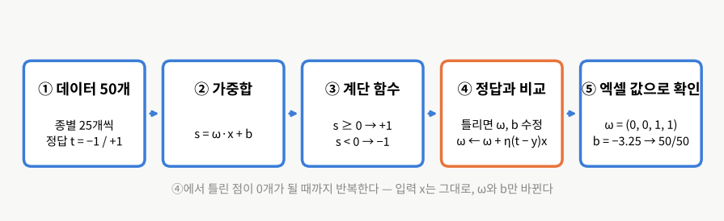
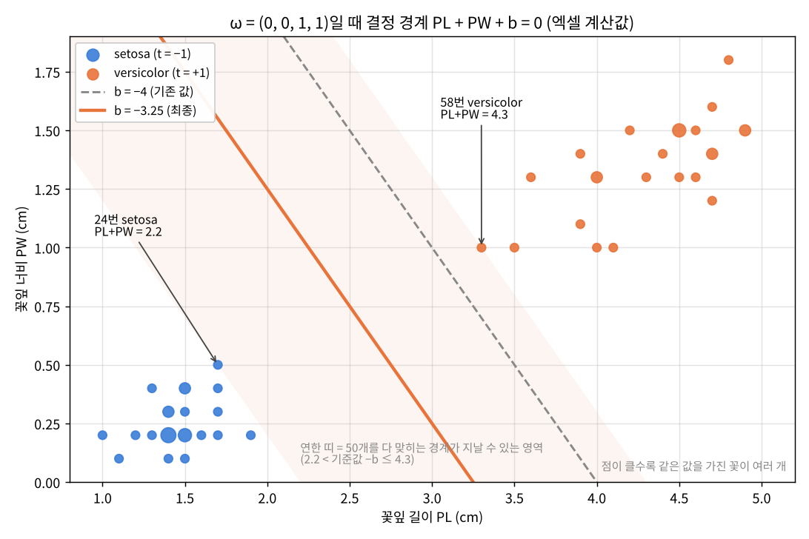
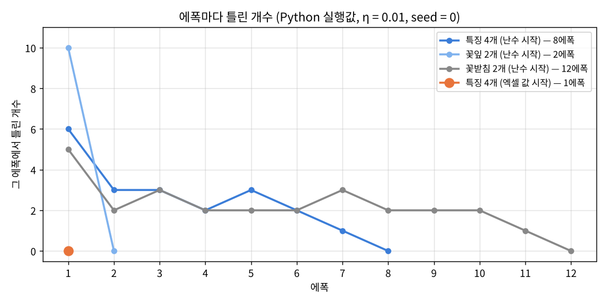

# 퍼셉트론 — 붓꽃 50개 이진 분류

인공지능개론 12주차 실습·과제 · 인공신경망 (단층 퍼셉트론)  
과제로 수업 참고 코드 `iris_perceptron.py`의 붓꽃 데이터를 **10개 → 50개**로 늘리고 → 엑셀에서 b를 바꿔가며 50개를 모두 맞히는 **ω, b를 직접 찾은 뒤** → 그 값을 코드에 넣어 퍼셉트론이 첫 에폭부터 다 맞히는지 확인했다.

> **퍼셉트론 = 가중합 s = ω·x + b (선형회귀와 같은 부분) + 계단 함수 (활성화 함수).** 정답과 예측이 다를 때만 ω와 b를 고친다. 입력 x는 못 바꾸고 ω와 b만 바뀐다.

| 파일 | 내용 |
| --- | --- |
| `iris_perceptron.py` | **과제** — 수업 참고 코드를 붓꽃 50개(setosa 1~25번, versicolor 51~75번)로 확장. 엑셀에서 찾은 ω, b로 시작하는 실행(0)을 추가하고, 특징 4개 / 꽃잎 2개 / 꽃받침 2개를 난수 시작으로 학습 |
| `perceptron_simulation.xlsx` | 엑셀 시뮬레이션 — 붓꽃 50개, b를 바꿔가며 50개를 다 맞히는 값(-3.25)을 찾은 과정 |

- 표준 라이브러리만 쓴다. `python iris_perceptron.py`로 바로 실행된다.
- 정답은 setosa = −1, versicolor = +1이다. 계단 함수는 `s >= 0`이면 +1, 아니면 −1이다.
- 원본 코드에서 바꾼 곳은 네 군데다.
  - `RAW_DATA` 10개 → 50개. 줄 끝 주석이 원본 Iris 데이터셋의 행 번호다. 수업에서 받은 10개(1, 2, 3, 5, 6번 / 51~55번)도 그대로 들어 있다.
  - 엑셀에서 찾은 값 `EXCEL_W = [0, 0, 1, 1]`, `EXCEL_B = -3.25` 추가.
  - `Perceptron(..., init_w=None, init_b=0.0)` — 시작 ω, b를 정해 줄 수 있게 했다. 안 주면 원래처럼 난수(`seed=0`)로 시작한다.
  - `main()` 맨 앞에 엑셀 값으로 시작하는 실행 (0) 추가.

**엑셀로 b 찾기 (엑셀 계산값)**

수업 엑셀 `붓꽃 분류` 시트에 50개를 넣고, 시트에 원래 있던 ω = (0, 0, 1, 1)은 그대로 둔 채 b만 바꿔 봤다.

- ω = (0, 0, 1, 1)이면 꽃받침 항이 0이 돼서 s = PL + PW + b다.
- PL + PW는 setosa 중 최대가 **2.2(24번)**, versicolor 중 최소가 **4.3(58번)**이다.

| b | 맞춘 개수 | 비고 |
| --- | --- | --- |
| −4 (기존 값) | 50 / 50 | 다 맞지만 58번 versicolor가 0.3 차이로 경계에 거의 붙어 있음 |
| −4.4 | 49 / 50 | 58번 versicolor가 틀림 |
| −2.2 | 49 / 50 | 24번 setosa가 틀림 |
| **−3.25 (최종)** | **50 / 50** | 2.2와 4.3의 가운데 → 양쪽 모두 1.05 차이 |

- b가 −4.3 이상 −2.2 미만이면 50개를 다 맞힌다. 그중 두 꽃의 가운데 (2.2 + 4.3) / 2 = 3.25를 기준으로 잡아 **b = −3.25**로 정했다.

**결과 요약**

- `iris_perceptron.py`를 직접 실행한 값이다 (Python 실행값). η = 0.01, 최대 50에폭, `seed = 0`.

| 실행 | 시작값 | 특징 | 수렴 에폭 | 학습된 식 | 정확도 |
| --- | --- | --- | --- | --- | --- |
| (0) | **엑셀 값** | 4개 | **1** (첫 에폭 틀린 개수 0) | s = PL + PW − 3.25 | 50 / 50 |
| (1) | 난수 | 4개 | 8 | s = 0.020·SL − 0.152·SW + 0.209·PL − 0.093·PW − 0.120 | 50 / 50 |
| (2) | 난수 | PL, PW | 2 | s = 0.054·PL + 0.208·PW − 0.200 | 50 / 50 |
| (3) | 난수 | SL, SW | 12 | s = 0.130·SL − 0.178·SW − 0.120 | 50 / 50 |

- (0)은 시작부터 50개를 다 맞혀서 ω, b가 한 번도 바뀌지 않는다. 엑셀에서 찾은 값이 맞다는 확인이다.
- 난수로 시작해도 세 경우 모두 50개를 다 맞혔다. 학습된 식은 엑셀 값과 다르지만 결과는 같다.

**정리**
1. 퍼셉트론은 입력 → 가중합(ω·x + b) → 활성화 함수 → 출력 순서로 동작한다.
2. 정답과 예측이 다르면 ω와 b를 고치고, 다 맞을 때까지 반복한다. b를 바꾸면 경계선이 평행 이동한다.
3. 50개를 다 맞히는 b는 범위로 존재한다(−4.3 이상 −2.2 미만). 그중 양쪽 끝 꽃의 가운데에 경계를 두는 값을 골랐다.
4. 엑셀에서 찾은 값으로 시작하면 코드도 첫 에폭에 다 맞힌다.
