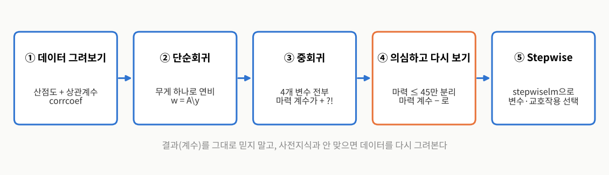
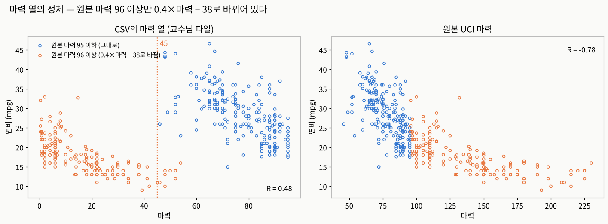

# 회귀분석 — 자동차 연비 예측 (Auto MPG)

인공지능개론 9주차 실습·과제 · 상관, 회귀분석  
배기량·마력·무게·가속으로 연비(mpg)를 예측한다. 상관계수로 관계를 먼저 보고, 단순회귀와 중회귀(최소제곱법)를 거쳐 → 마력 계수가 상식과 반대로 나오는 걸 확인한 뒤 → 과제로 **마력 45 이하 데이터만** 골라 **Stepwise**로 모델링했다.

> **회귀 = 잔차 제곱합 J = eᵀe를 최소로 만드는 계수 찾기 → 정규방정식 AᵀAω = Aᵀy → ω = (AᵀA)⁻¹Aᵀy (MATLAB에서는 `A\y`).** 계수가 사전지식과 반대로 나오면 모델보다 데이터를 먼저 의심하고 다시 그려본다.

| 파일 | 내용 |
| --- | --- |
| `auto-mpg_ex.csv` | 수업 데이터 392개 — 1열 mpg(연비), 2열 disp(배기량), 3열 hp(마력), 4열 wt(무게), 5열 accler(가속). 헤더 없음 |
| `correlation_ex.m` | 독립변수 4개와 연비의 `corrcoef` + 2×2 산점도 |
| `regression_ex1.m` | **단순회귀** — 무게 하나로 연비 예측. `A\y`, `(AᵀA)⁻¹Aᵀy`, `regress` 세 방법으로 같은 계수 확인 + 오차 3종(MAE, %error, RMSE) |
| `regression_ex2.m` | **중회귀** — 4개 변수 전부, 절편용 1 열을 붙인 A로 최소제곱 |
| `regression_ex3.m` | 마력 45 이하만 골라 산점도·상관계수 → 4변수 중회귀 |
| `regression_ex4.m` | 전체 데이터에 `stepwiselm` 적용, 선택된 항으로 `y_est` 계산 |
| `HW_regression_202310859.m` | **과제** — 마력 45 이하 데이터에 `stepwiselm` 적용, 선택된 항(교호작용 포함)으로 추정·오차 계산 |

- `stepwiselm(A, y)`를 옵션 없이 부르면 상수항만으로 시작해서 **교호작용(x1:x3 같은 두 변수 곱)까지** 후보로 본다(추가 p < 0.05, 제거 p > 0.10). 그래서 `y_est`는 선택된 항을 보고 직접 써야 하고, 데이터가 바뀌면 그 줄도 바뀐다.
- `A`에 넣은 1 열(x5)은 `stepwiselm`이 알아서 절편을 넣기 때문에 선택되지 않는다.

**버그·특이점 — 마력 열의 정체**

- 원본 UCI 마력은 46\~230인데 CSV의 마력은 0.4\~95다. 원본과 행을 맞춰보니 **원본 마력 96 이상인 차만 `0.4 × 마력 − 38`로 바뀌어 있고**, 95 이하는 그대로였다(392개 전부 오차 0).
- 그래서 산점도가 두 덩어리로 갈라지고, 전체 상관계수가 +0.48로 나오며, 중회귀에서 마력 계수가 **+0.0177**(마력이 높을수록 연비가 좋다)로 나온다. 원본 마력으로 계산하면 상관계수는 −0.78이다.
- "마력 45 이하"로 고른 171개는 사실 **원본 마력 96\~200인 차들**이다. 한 덩어리만 남으니 마력 계수가 다시 음수가 된다.
- 슬라이드의 회귀식 중 무게 계수 `−0.058`(ex2)과 `−0.029`(ex3)는 실제로 `−0.0058`, `−0.0029`다(소수점 자리 오타). 나머지 계수는 슬라이드와 같다.

**결과 요약**

- 과제는 MATLAB R2026a에서 `HW_regression_202310859.m`을 직접 실행해 확인한 값이다. ex1\~ex4는 같은 계산을 Python으로 재현한 값이고(MATLAB에서 직접 확인한 값 아님), 계수는 슬라이드의 회귀식과 소수 4자리까지 같다.

| | 데이터 | 모델 | MAE | %error | RMSE |
| --- | --- | --- | --- | --- | --- |
| ex1 | 전체 392 | 연비 = −0.0076·무게 +
